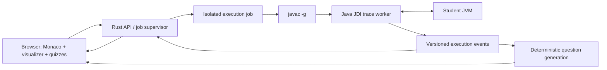

# Java visual debugging IDE — hackathon plan

Research checked: October 24, 2026. Working product name: **TraceLab**.

## Recommendation

Build a browser IDE for Java first: Monaco + TypeScript for the interface, a Rust service for job orchestration, and a small Java JDI worker for collecting real JVM execution states. Use a language-independent trace format so the interface and quiz engine can support additional runtimes later.

The product promise is **“Understand the bug, predict the fix, prove it works.”** Multi-language visualization alone is not a differentiator: Python Tutor already supports Python, Java, JavaScript, C, and C++.

Avoid a full VS Code fork during the hackathon. Monaco provides its editor component; it does not include the VS Code workbench, Java language service, extension host, or debugger. Add the few IDE features the demo needs explicitly. If full extension compatibility becomes a hard requirement, evaluate an existing browser workbench and a debugger extension separately.

## Status — October 24, 2026

The prototype meets the definition of done below and runs locally (`npm run build`, `npm start`). `npm test` runs 39 checks against real JVM runs. Details are in [README.md](README.md) and [docs/PROTOCOL.md](docs/PROTOCOL.md).

| Opportunity | Status |
| --- | --- |
| 1 · Projects, not snippets | Multi-file projects, packages, rename/delete, autosave, import/export, share links in the URL fragment |
| 2 · Useful limits | Step/time/output/trace budgets; partial traces kept and labelled; cancellation |
| 3 · Readable memory | Stack and heap columns with reference arrows (hover isolates one), inline strings and boxed values, change/new highlights, filters, renderers for common JDK lists, maps, sets, deques and `StringBuilder` |
| 4 · Line-level honesty | A “Changed” strip narrates differences between recorded stops, including calls and return values; no claims about subexpressions |
| 5 · Real Java | JDK 21 compilation and JDI capture; collection views read JDK fields without calling target methods |
| 6 · Guidance | Predict/explain/fix questions for array and string bounds, null fields and `Map.get` misses, division by zero, parsing, concurrent modification, non-terminating loops, runaway recursion, string identity, integer division, pass-by-value, aliasing, return values and compiler errors; each repair quotes the recorded line, and tests verify the student’s own edit |

Debugger controls include step into/back, frame-aware over/out/back over (F10, Shift+F11, Shift+F10), replay bookmarks and run history.

The product now has a landing page (`/`) with a feature overview, FAQ and an 18-example gallery, and a VS Code-style IDE (`/app/`) with an activity bar, Explorer and Examples views, light/dark themes, a Tutor panel and a status bar. Fourteen examples contain bugs across runtime errors, wrong output, non-termination and compile errors; each has failing tests, an explain question and a repair question, and the test suite verifies that the Tutor's repair makes every test pass.

Still open, in suggested order: a form-based test editor; semantic Java completion through Eclipse JDT LS; expression-level explanations; a second language adapter against the same trace contract; and isolated execution before any public deployment.

## Python Tutor: evidence and opportunities

These are prioritized product opportunities, **not a statistically ranked survey of complaints**. Some are deliberate limits of an introductory teaching tool. The maintained website and historical repository documentation differ; treat old version-specific statements as items to reproduce, not proof of today's hosted behavior.

| Priority | Documented limitation | What to build | MVP acceptance check |
| --- | --- | --- | --- |
| 1 | Small, self-contained examples; limited multi-file/project workflow | File explorer, Java tabs, autosave, project import/export | Compile and trace a program spanning `Main.java` and `Counter.java` |
| 2 | Trace length and runtime limits; historical reports of timeouts without useful partial results | Explicit budgets, partial trace retention, clear stop reason, breakpoint navigation | Infinite loop stops with a useful recorded trace and a visible limit message |
| 3 | Many objects and variables become hard to inspect; historical Java collection rendering gaps | Stable object identities, expandable object cards, array indices, changed-value highlights, watch filters | Two references to one object stay visibly linked; a mutated array cell is highlighted |
| 4 | Execution is shown at source-line granularity, not subexpression evaluation | Explain observed state changes; later add a carefully scoped expression evaluator | Never claim a line-level JDI snapshot proves every intermediate expression value |
| 5 | Introductory runtime and library scope; historical Java maintenance/version concerns | Use a supported JDK, test ordinary Java classes, arrays, recursion and selected collections | Test actual compilation and runtime events instead of simulating Java with regexes |
| 6 | Visualization by itself may still leave a student needing guidance | Trace-grounded predict/explain/repair questions, hints, and rerun-based checks | A question references a specific observed event and accepts a repair only when checks pass |

The official homepage already encourages teachers to have students predict the next step. Do not claim to invent prediction exercises or assume Python Tutor has no teaching features. Our proposed distinction is integrating questions and repair verification into a persistent project workflow.

### Sources

- [Python Tutor current homepage](https://pythontutor.com/) — current languages and classroom use.
- [Current Java visualizer](https://pythontutor.com/java.html) — Java already exists.
- [Project unsupported-features document](https://github.com/pythontutor-dev/pythontutor/blob/master/unsupported-features.md) — project scope, execution limits, object scale, Java collection caveats, and IDE exclusions. Historical implementation/version details need validation against the hosted service.
- [Guo, SIGCSE 2013 paper](https://pg.ucsd.edu/publications/Online-Python-Tutor-web-based-program-visualization_SIGCSE-2013.pdf) — original design and line-level/expression-level visualization limitations; historical evidence, not a current review.

## Architecture



### Why these languages

- **TypeScript:** the browser interface and Monaco integrations. Writing the whole UI in a systems language adds work without making the teaching experience better.
- **Rust:** HTTP endpoints, job lifecycle, deadlines, quotas, cancellation and trace transport. A low-level implementation language is useful here, but is not itself a sandbox.
- **Java:** JDI is the supported Java API for inspecting another JVM. A small worker avoids implementing the binary JDWP protocol from scratch in Rust.
- **JDK 21 baseline:** a practical initial target; pin an exact tested distribution/version in the execution image. Expand supported language levels only after testing.

Sources: [Monaco](https://github.com/microsoft/monaco-editor), [JDI module documentation](https://docs.oracle.com/en/java/javase/25/docs/api/jdk.jdi/module-summary.html), [Eclipse JDT Language Server](https://github.com/eclipse-jdtls/eclipse.jdt.ls).

### IDE scope

MVP: multi-file editing, syntax highlighting, line numbers, find/replace, compile diagnostics, input/output, run, trace replay, bookmarks/breakpoints, local project persistence, import/export.

Later: Eclipse JDT LS for semantic autocomplete, navigation, refactoring and as-you-type diagnostics. Monaco's Java syntax highlighting alone is not semantic Java IntelliSense. Maven/Gradle dependency resolution and full terminal access are separate capabilities, not implicit editor features.

### Real execution, not an imitation

1. Validate file paths, project size, entry point, stdin and job settings.
2. Create an isolated workspace; compile source files using `javac -g -proc:none` with argument arrays, not shell interpolation.
3. Launch the target JVM suspended through JDI, with a bounded heap and supplied stdin.
4. Record user-code line events, stack frames, local variables, reachable objects, selected static fields, exceptions and output.
5. Capture values without invoking methods on student objects: calling `toString()` can mutate state or run indefinitely.
6. Bound object traversal, nesting, array previews, output bytes, event count and elapsed time. Mark omitted data explicitly.
7. Preserve every available trace event if execution fails or exceeds its budget.
8. Let the browser replay immutable snapshots forward and backward.

Backward navigation is **recorded-state replay**, not reverse execution of arbitrary external effects. Store the source revision and input alongside each trace; editing source invalidates its correspondence with the old line highlights. Distinguish the next line to execute from the line that just executed.

### Multi-language contract

```ts
type TraceEvent = {
  schemaVersion: 1;
  runId: string;
  sequence: number;
  kind: 'line' | 'exception' | 'output' | 'terminated';
  threadId?: string;
  location?: { file: string; line: number; phase: 'before' | 'after' };
  frames: Frame[];
  heap: HeapObject[];
  stdoutDelta?: string;
  stderrDelta?: string;
  exception?: { type: string; message: string; caught: boolean };
  stopReason?: 'completed' | 'exception' | 'timeout' | 'step-limit' | 'cancelled';
};
```

Give frames and objects stable identities within a run, preserve declared types, and distinguish null, primitives and references. Extend the schema for language-specific semantics instead of pretending Java references and C pointers behave identically. Have adapters advertise capabilities (heap, watchpoints, exceptions, threads, expression steps).

Potential future adapters: Python tracing/debugger hooks, JavaScript Inspector, C/C++ through an existing debugger. These are roadmap items. A generic debugger protocol alone does not guarantee historical heap snapshots or identical visualization support.

## The learning loop

1. Student runs a program with a bug.
2. The visualizer opens at an observed exception or a test failure, showing the relevant state.
3. **Predict:** “The array has length 3 and `i` is 3. What happens at `values[i]`?”
4. **Explain:** “Which loop condition admits an invalid index?”
5. Reveal progressively stronger hints after attempts.
6. **Repair:** student edits the code themselves.
7. Recompile and rerun the stated checks; show the resulting behavior and which checks passed.

Start with deterministic question templates for array bounds, null dereferences, integer division and object aliasing. Only ask questions whose premises are supported by the recorded state or a verified assignment/test. Avoid asserting that every suspicious construct is a bug.

Incorrect intended output cannot be inferred reliably from arbitrary source alone. Accept an expected output, test cases, or an exercise specification. Passing a finite set of tests verifies those cases, not universal correctness. An optional model can phrase questions and hints from verified trace evidence later; it should not invent execution values or decide correctness by itself.

## Hackathon cut

Assumption: 24–48 hours and a small team. The sequencing matters more than the hour estimates.

| Phase | Deliverable | Exit criterion |
| --- | --- | --- |
| First 4–6 hours | Compile and trace one Java program | Real local-variable and array values reach the browser |
| Next 6–10 hours | Editor + stack/heap + replay | Recursion and aliasing are understandable; source/trace stay aligned |
| Next 4–6 hours | One complete guided debugging exercise | Predict, explain, edit, rerun, and verify all work |
| Next 4–6 hours | Multi-file save/load, input, errors, execution budgets | Demo survives compilation errors and infinite loops |
| Remaining time | UX polish and rehearsal | A three-minute demo runs without manual backstage work |

Defer extra languages, collaborative editing, full Git integration, arbitrary package installation, concurrency visualization, expression-level stepping and a VS Code fork. Add selected collection renderers only after ordinary arrays and object identities work.

## Demo script

Use a two-file Java project that sums an array with `i <= values.length`.

1. Open the project and run it.
2. Step through the array with its indices and `i` visible. Use **Over** at `ArraySum.sum(values)` to show frame-aware stepping, then step into it.
3. At the exception, show `i == length` and the valid index range.
4. Ask the student to explain the failed access before revealing a hint.
5. Answer the repair question, which quotes line 6 from the recorded source, then use **Edit ArraySum.java, line 6**.
6. Change `<=` to `<`, check the repair, and show passing checks for empty, one-element and ordinary arrays.
7. Replay before and after separately with their own source revision.

Optional 60-second extensions, all reachable from the landing page gallery: **Walking a chain** for reference arrows; **Same text, different objects** for `==` vs `equals`, then **Debug this test** on the failing test; **Removing while looping** for `ConcurrentModificationException`; **Recursion with no way out** for a missing base case; **Half of seven** for a compiler error explained by the Tutor.

## Execution and deployment boundary

Browser editing and replay can be statically hosted. Compiling and tracing Java requires a separate process-capable execution service; a static website or ordinary edge Worker cannot substitute for a JVM runner.

For a public service, run each untrusted compilation and JVM in an isolated job with no host credentials, no outbound network by default, bounded CPU/memory/processes, restricted filesystem, unprivileged identity, timeouts, cleanup and per-user concurrency quotas. Include compilation and annotation processing in the threat model. Do not expose JDWP to the public network.

A localhost-only development runner can demonstrate trusted sample programs, but must be described as such. A subprocess timeout and `-Xmx` are resource limits, not isolation from the developer's filesystem or network. Production sandboxing is part of making a public code-execution service work, not a cosmetic add-on.

## Definition of done for the prototype

- Executes real Java; a frontend mock is clearly separate from runnable mode.
- Displays stack frames, locals, arrays and shared object references.
- Replays recorded steps both ways and preserves source revision.
- Handles multiple source files and captures compiler diagnostics.
- Offers stdin and stdout/stderr.
- Preserves partial traces on limits and labels them.
- Generates at least one question from the student's observed execution.
- Reruns edited code against explicit checks before reporting success.
- Documents unsupported language/runtime features and deployment limits.

## Workspace discovery

The starting workspace was empty. Node.js is available. The Java on PATH is a Java 8 runtime without `javac`; a newer JDK with `javac` was found bundled with the local VS Code Java extension. Rust is not on PATH. Docker's CLI exists but its daemon was not reachable during inspection. These are local setup observations, not portable project requirements.
