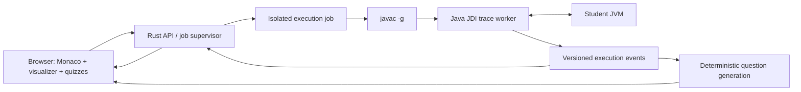

# Java visual debugging IDE — hackathon plan

Research checked: October 24, 2026. Working product name: **TraceLab**.

## Recommendation

Build a browser IDE for Java first: Monaco + TypeScript for the interface, a Rust service for job orchestration, and a small Java JDI worker for collecting real JVM execution states. Use a language-independent trace format so the interface and quiz engine can support additional runtimes later.

The product promise is **“Understand the bug, predict the fix, prove it works.”** Multi-language visualization alone is not a differentiator: Python Tutor already supports Python, Java, JavaScript, C, and C++.

Avoid a full VS Code fork during the hackathon. Monaco provides its editor component; it does not include the VS Code workbench, Java language service, extension host, or debugger. Add the few IDE features the demo needs explicitly. If full extension compatibility becomes a hard requirement, evaluate an existing browser workbench and a debugger extension separately.

## Status — October 24, 2026

The prototype meets the definition of done below and runs locally (`npm run build`, `npm start`). `npm test` runs 56 checks against real JVM runs. The code is on the `Java` branch of [MishraAsh2007/Hackachusetts_CodeTutor](https://github.com/MishraAsh2007/Hackachusetts_CodeTutor/tree/Java). Details are in [README.md](README.md) and [docs/PROTOCOL.md](docs/PROTOCOL.md).

| Opportunity | Status |
| --- | --- |
| 1 · Projects, not snippets | A project library (create, rename, duplicate, delete), templates, pasted code split into files, `.java`/folder/zip import placed by package, a package-tree Explorer with path warnings and one-click moves, zip export with tests, and share links |
| 2 · Useful limits | Step/time/output/trace budgets; partial traces kept and labelled; cancellation |
| 3 · Readable memory | Stack and heap columns with reference arrows (hover isolates one), inline strings and boxed values, change/new highlights, filters, renderers for common JDK lists, maps, sets, deques and `StringBuilder` |
| 4 · Line-level honesty | A “Changed” strip narrates differences between recorded stops, including calls and return values; no claims about subexpressions |
| 5 · Real Java | JDK 21 compilation and JDI capture; collection views read JDK fields without calling target methods |
| 6 · Guidance | Predict/explain/fix questions for array and string bounds, null fields and `Map.get` misses, division by zero, parsing, concurrent modification, non-terminating loops, runaway recursion, string identity, integer division, pass-by-value, aliasing, return values and compiler errors; each repair quotes the recorded line, and tests verify the student’s own edit |

Debugger controls include step into/back, frame-aware over/out/back over (F10, Shift+F11, Shift+F10), replay bookmarks and run history.

The product now has a landing page (`/`) with a feature overview, FAQ and a 21-example gallery, and a VS Code-style IDE (`/app/`) with an activity bar, Explorer and Examples views, light/dark themes, a Tutor panel and a status bar. Fourteen examples contain bugs across runtime errors, wrong output, non-termination and compile errors; each has failing tests, an explain question and a repair question, and the test suite verifies that the Tutor's repair makes every test pass.

## Roadmap after the first release

Agreed on October 24, 2026. Each phase ships with integration tests and a browser check, then is pushed to the `Java` branch. Optional AI help (layer C below) is deferred: it would need an API key and would send student code to a third party.

### Phase 1 — Your own projects and tests ✅ done

| Item | Shipped |
| --- | --- |
| Many projects | Browser-local library with a **My projects** view and a top-bar project switcher; rename, duplicate, export, delete; the TraceLab 1.0 single workspace migrates automatically |
| Examples as templates | Example edits are stored per example and never overwrite a project; **Save as my project** copies one, **Reset** restores it |
| New projects | Templates (blank, reads input, class + Main, packages), paste code (several public classes are split into files), `?new` link |
| Import | `.java` files, folders, zips and TraceLab `.json`, by chooser or drag and drop; files are placed by `package` and public class name; main class detected |
| Explorer | Package folders, main-class badge, “run from this class”, path/package warnings with one-click **Move**, rename/move that updates the class and package declarations |
| Tests | A form editor; **method-call tests** (`sum(new int[]{1, 2})` → `3`, values, arrays, collections, `throws X`) run through a generated harness; **save this run’s output as a test**; a failing method test can be recorded and stepped through |
| Export | Zip with `src/` and `tracelab.json`, which re-imports with its tests |

### Phase 1.5 — Feedback from the first users ✅ done

| Feedback | Shipped |
| --- | --- |
| “I can’t find how to start a new project” | **New project** in the top bar and **+** in the activity bar, besides the project switcher, ⋯ menu and My projects view. The My projects view was always there, but empty until the first project, and the sidebar starts collapsed on screens under 1500 px |
| “I can’t add files to an example” | It worked from the Explorer, which was hidden with the sidebar. **New file** and **Add files** now also sit in the editor tab bar |
| Help with compile errors | Plain-language explanations for about 30 javac messages; concrete fixes that TraceLab compiles in the background before labelling them; apply-and-rerun, Ctrl+Z, and Monaco quick fixes (Ctrl+.). Monaco’s editor contributions (find, hovers, suggestions, quick fixes, F1) are now loaded |
| Generate tests for my own programs | Sample arguments for static methods with common parameter types, run in one JVM; a review table where the student confirms or corrects each value (characterization tests) |
| “It doesn’t show where we are in the array” | Index markers for `a[i]`, `list.get(i)`, `s.charAt(…)`, `grid[r][c]` and for-each loops, evaluated from recorded values; out-of-range indexes drawn past the end |
| Fast mode (from phase 2) | `run` (no recording) and `compile` modes in the runner; Run tests batches method tests into one JVM |

### Phase 1.6 — A real IDE, more help, optional AI ✅ done

| Request | Shipped |
| --- | --- |
| “Enable all the functionality of an IDE” | Eclipse JDT LS behind the runner (found in the VS Code Java extension or installed with `npm run setup:jdtls`) and a small LSP client: typed completion with auto-import, hovers, signature help, definition, references, rename across files, refactorings, quick fixes, organize imports, formatting, inlay hints, errors as you type. Spelling in comments, strings and names |
| “Catch even more errors” deterministically | JDT warnings for bugs that compile (`if (…);`, `x = x`, null-only variables, fall-through, unrelated `equals`) with plain-language explanations; an explain question for every uncaught exception type |
| “Need help” with more visualizations | Built only from the recording: what happened, a per-step value table with loop passes, cells read (out-of-range marked), recursive calls with results, expected vs. printed output |
| “Practice” after a question | Randomized problems for 16 concepts; the answer is what the JVM did, distractors are common misconceptions; can be opened as a project and traced |
| AI when the deterministic tools can’t help, “Ask assistant” | Optional and off by default: any OpenAI-compatible endpoint (Ollama locally, Gemini free tier, Groq, OpenRouter, LM Studio). Context is the code, the recording, the current step and the open question (answer withheld). A Kiro key can’t serve this: Kiro API keys only authenticate its CLI and need a paid plan |

Still open from this request: tested AI fix suggestions. (AI-written practice shipped in the data structures phase below.)

Follow-up (October 24): **Reset** for examples and projects; a tree view for binary trees; views for `Stack`/`Vector`, `List.of`/`Set.of`/`Map.of` and unmodifiable wrappers (previously opaque); tours for a binary search tree, BFS and DFS; Groq (`openai/gpt-oss-120b`) as the tested hosted assistant.

### Phase 1.7 — Data structures and algorithms ✅ done

Checked first with BST insert/in-order, BFS on an adjacency list, recursive grid flood fill, DFS with a `HashMap` graph and a `Stack`, merge sort, Dijkstra with a `PriorityQueue<int[]>`, records and enums, a generic linked list with interfaces, and `fib(15)`. The seven gaps found, and what shipped:

| Gap | Shipped |
| --- | --- |
| 1. Longer runs: the 2,000-step budget ran out early (`fib(15)` needs 1,983) | **Start recording here** (editor right-click, settings): run untraced until a line is about to run, optionally with a condition (`i == 50 && total > 100`) and a hit count, then record. Only the trigger line is watched until then: `fib(20)` (21,891 calls) runs before the start point in about a second. Clear messages when the point never fires |
| 2. More objects per step (64 objects, 32 elements, 24 frames, 12 levels) | 160 objects, 64 elements, 48 frames, 48 levels, 64 returns between stops; 15 s runs and a 40 MiB trace. Primitive arrays travel compactly, boxed values are read once. Building the runner's dependencies optimized removed a JSON-parsing bottleneck: 1,206 steps with 60–70 objects each now record in about 6 s instead of 18 s |
| 3. Graph view | Adjacency lists (`List<List<Integer>>`, `List<Integer>[]`, jagged `int[][]`), adjacency matrices and edge lists (by name), `Map<K, List<K>>` / `Map<K, Map<K, W>>`, and node objects with neighbor lists. Layered left to right by distance from the start; visited from `boolean[]`/`dist`/`parent`/`color` arrays, sets and maps; queue or stack contents numbered in removal order; the current node, the neighbor being checked, and the path of recursive DFS calls |
| 4. Recursion tree in the debugger | A call tree for any recursive method (and helpers it calls), with arguments, results and the running call, growing as you step; long chains lay out sideways; click a call to jump to it |
| 5. Algorithm-aware questions and practice | Tutor: which value `poll`/`remove`/`pop` returns (FIFO, LIFO, priority), how many calls a recursion makes, which call returns first, which call starts next (depth first). Practice: BFS order and distances, recursive and stack DFS, BST traversals and height, binary search probes and steps, bubble/selection/insertion sort passes. Plus AI-written practice: the model writes the program and wrong answers, an API allowlist screens it, and the JVM gives the answer |
| 6. Grid view | 2D arrays as grids with `grid[r][c]` row/column markers, a same-size `visited[][]` shown as colors, walls, and `{r, c}` cells in a queue numbered |
| 7. More JDK views | Map `keySet`/`values`/`entrySet` and entries, iterators, `Optional`, `BitSet`, `java.time`, atomics, `BigInteger`/`BigDecimal`, `UUID`, `EnumMap`/`EnumSet`, empty/singleton collections, `subList`, JDK enum constants |

All structure views grow sideways and scroll, keep their scroll position across steps, bring the current node into view, fold, and open larger over the debugger with step buttons (Esc closes). Linked lists are drawn as chains.

Follow-up (October 24): **tests and honest explanations.** A blank project used to start with a "Prints a greeting" test, so any real program failed it and the Tutor and Need help explained a bug that didn't exist. Now the blank template has no tests; other template tests are marked as starter tests and a failure is reported as "this test may be out of date" with **Remove it**; every failing test says who might be wrong (starter, generated from old code, AI guess, or yours). A run with no errors gets a verdict ("No problems found", or "No errors, but no tests say what it should do") and no Need help. Test generation covers instance methods (on objects it can build), records and `void` methods (by what they print), spreads samples across methods, and supports statement calls (`Counter c = new Counter(); c.add(2); c.value()`). **Ask the AI** suggests tests for what the code *should* do; every suggestion runs on the JVM, and disagreements are shown, not trusted.

Next for this area: capture only what the current frame can reach when a heap is very large, Dijkstra-style weighted priority queues of `int[]` pairs on graphs, a “what does the queue hold after this iteration” question, and AI-written practice with a tracing step before it is shown.

### Phase 2 — General Tutor questions and tested fixes

- **A. Questions from any recording.** Extract facts from every run (value changes of any type, which line runs next and which branch was taken, loop iteration counts, calls and returns, output, the values on a throwing line) and build questions from them: “what is `x` after this line?”, “which line runs next?”, “how many times does line 7 run?”, “what does `f(3)` return?”, “which value caused the exception?”, “where does the output first differ from the test?”. Wrong answers come from common mistakes: the old value, off by one, another variable, the branch not taken. Correct answers always come from the recording.
- **B. Tested fixes.** Try small standard edits near the failing lines (`<` ↔ `<=`, ±1, `==` → `equals`, cast before dividing, initialize a field, add a missing update, `&&` ↔ `||`), run each against the project’s tests on the real JVM, and offer only verified fixes as correct answers, with compiled-but-failing edits as distractors. Without tests, say that “the exception went away” is weaker evidence. Keep the hand-written questions where their wording is clearer.
- ~~**Fast mode:** run tests without recording for speed.~~ Shipped in phase 1.5; tested fixes can use the same `run` mode and batch harness.

### Phase 3 — Debug larger programs

Start recording at a breakpoint (with conditions such as `i == 9999` or a hit count) instead of from the first line; watch expressions read from the recording; renderers for enums, records, 2D arrays and `char[]`; about ten more example bugs (2D off-by-one, an unexpected override, a shared static counter, ignoring `toUpperCase()`’s result, `Integer` caching at 127/128, `0.1 + 0.2 == 0.3`, switch fall-through, `value = value` in a constructor, `equals` without `hashCode`).

### Phase 4 — Optional

Multithreaded recording with a thread picker (highest risk); semantic completion through Eclipse JDT LS; a second language adapter against the same trace contract; isolated execution before any public deployment.

## Python Tutor: evidence and opportunities

These are prioritized product opportunities, **not a statistically ranked survey of complaints**. Some are deliberate limits of an introductory teaching tool. The maintained website and historical repository documentation differ; treat old version-specific statements as items to reproduce, not proof of today's hosted behavior.

| Priority | Documented limitation | What to build | MVP acceptance check |
| --- | --- | --- | --- |
| 1 | Small, self-contained examples; limited multi-file/project workflow | File explorer, Java tabs, autosave, project import/export | Compile and trace a program spanning `Main.java` and `Counter.java` |
| 2 | Trace length and runtime limits; historical reports of timeouts without useful partial results | Explicit budgets, partial trace retention, clear stop reason, breakpoint navigation | Infinite loop stops with a useful recorded trace and a visible limit message |
| 3 | Many objects and variables become hard to inspect; historical Java collection rendering gaps | Stable object identities, expandable object cards, array indices, changed-value highlights, watch filters | Two references to one object stay visibly linked; a mutated array cell is highlighted |
| 4 | Execution is shown at source-line granularity, not subexpression evaluation | Explain observed state changes; later add a carefully scoped expression evaluator | Never claim a line-level JDI snapshot proves every intermediate expression value |
| 5 | Introductory runtime and library scope; historical Java maintenance/version concerns | Use a supported JDK, test ordinary Java classes, arrays, recursion and selected collections | Test actual compilation and runtime events instead of simulating Java with regexes |
| 6 | Visualization by itself may still leave a student needing guidance | Trace-grounded predict/explain/repair questions, hints, and rerun-based checks | A question references a specific observed event and accepts a repair only when checks pass |

The official homepage already encourages teachers to have students predict the next step. Do not claim to invent prediction exercises or assume Python Tutor has no teaching features. Our proposed distinction is integrating questions and repair verification into a persistent project workflow.

### Sources

- [Python Tutor current homepage](https://pythontutor.com/) — current languages and classroom use.
- [Current Java visualizer](https://pythontutor.com/java.html) — Java already exists.
- [Project unsupported-features document](https://github.com/pythontutor-dev/pythontutor/blob/master/unsupported-features.md) — project scope, execution limits, object scale, Java collection caveats, and IDE exclusions. Historical implementation/version details need validation against the hosted service.
- [Guo, SIGCSE 2013 paper](https://pg.ucsd.edu/publications/Online-Python-Tutor-web-based-program-visualization_SIGCSE-2013.pdf) — original design and line-level/expression-level visualization limitations; historical evidence, not a current review.

## Architecture



### Why these languages

- **TypeScript:** the browser interface and Monaco integrations. Writing the whole UI in a systems language adds work without making the teaching experience better.
- **Rust:** HTTP endpoints, job lifecycle, deadlines, quotas, cancellation and trace transport. A low-level implementation language is useful here, but is not itself a sandbox.
- **Java:** JDI is the supported Java API for inspecting another JVM. A small worker avoids implementing the binary JDWP protocol from scratch in Rust.
- **JDK 21 baseline:** a practical initial target; pin an exact tested distribution/version in the execution image. Expand supported language levels only after testing.

Sources: [Monaco](https://github.com/microsoft/monaco-editor), [JDI module documentation](https://docs.oracle.com/en/java/javase/25/docs/api/jdk.jdi/module-summary.html), [Eclipse JDT Language Server](https://github.com/eclipse-jdtls/eclipse.jdt.ls).

### IDE scope

MVP: multi-file editing, syntax highlighting, line numbers, find/replace, compile diagnostics, input/output, run, trace replay, bookmarks/breakpoints, local project persistence, import/export.

Later: Eclipse JDT LS for semantic autocomplete, navigation, refactoring and as-you-type diagnostics. Monaco's Java syntax highlighting alone is not semantic Java IntelliSense. Maven/Gradle dependency resolution and full terminal access are separate capabilities, not implicit editor features.

### Real execution, not an imitation

1. Validate file paths, project size, entry point, stdin and job settings.
2. Create an isolated workspace; compile source files using `javac -g -proc:none` with argument arrays, not shell interpolation.
3. Launch the target JVM suspended through JDI, with a bounded heap and supplied stdin.
4. Record user-code line events, stack frames, local variables, reachable objects, selected static fields, exceptions and output.
5. Capture values without invoking methods on student objects: calling `toString()` can mutate state or run indefinitely.
6. Bound object traversal, nesting, array previews, output bytes, event count and elapsed time. Mark omitted data explicitly.
7. Preserve every available trace event if execution fails or exceeds its budget.
8. Let the browser replay immutable snapshots forward and backward.

Backward navigation is **recorded-state replay**, not reverse execution of arbitrary external effects. Store the source revision and input alongside each trace; editing source invalidates its correspondence with the old line highlights. Distinguish the next line to execute from the line that just executed.

### Multi-language contract

```ts
type TraceEvent = {
  schemaVersion: 1;
  runId: string;
  sequence: number;
  kind: 'line' | 'exception' | 'output' | 'terminated';
  threadId?: string;
  location?: { file: string; line: number; phase: 'before' | 'after' };
  frames: Frame[];
  heap: HeapObject[];
  stdoutDelta?: string;
  stderrDelta?: string;
  exception?: { type: string; message: string; caught: boolean };
  stopReason?: 'completed' | 'exception' | 'timeout' | 'step-limit' | 'cancelled';
};
```

Give frames and objects stable identities within a run, preserve declared types, and distinguish null, primitives and references. Extend the schema for language-specific semantics instead of pretending Java references and C pointers behave identically. Have adapters advertise capabilities (heap, watchpoints, exceptions, threads, expression steps).

Potential future adapters: Python tracing/debugger hooks, JavaScript Inspector, C/C++ through an existing debugger. These are roadmap items. A generic debugger protocol alone does not guarantee historical heap snapshots or identical visualization support.

## The learning loop

1. Student runs a program with a bug.
2. The visualizer opens at an observed exception or a test failure, showing the relevant state.
3. **Predict:** “The array has length 3 and `i` is 3. What happens at `values[i]`?”
4. **Explain:** “Which loop condition admits an invalid index?”
5. Reveal progressively stronger hints after attempts.
6. **Repair:** student edits the code themselves.
7. Recompile and rerun the stated checks; show the resulting behavior and which checks passed.

Start with deterministic question templates for array bounds, null dereferences, integer division and object aliasing. Only ask questions whose premises are supported by the recorded state or a verified assignment/test. Avoid asserting that every suspicious construct is a bug.

Incorrect intended output cannot be inferred reliably from arbitrary source alone. Accept an expected output, test cases, or an exercise specification. Passing a finite set of tests verifies those cases, not universal correctness. An optional model can phrase questions and hints from verified trace evidence later; it should not invent execution values or decide correctness by itself.

## Hackathon cut

Assumption: 24–48 hours and a small team. The sequencing matters more than the hour estimates.

| Phase | Deliverable | Exit criterion |
| --- | --- | --- |
| First 4–6 hours | Compile and trace one Java program | Real local-variable and array values reach the browser |
| Next 6–10 hours | Editor + stack/heap + replay | Recursion and aliasing are understandable; source/trace stay aligned |
| Next 4–6 hours | One complete guided debugging exercise | Predict, explain, edit, rerun, and verify all work |
| Next 4–6 hours | Multi-file save/load, input, errors, execution budgets | Demo survives compilation errors and infinite loops |
| Remaining time | UX polish and rehearsal | A three-minute demo runs without manual backstage work |

Defer extra languages, collaborative editing, full Git integration, arbitrary package installation, concurrency visualization, expression-level stepping and a VS Code fork. Add selected collection renderers only after ordinary arrays and object identities work.

## Demo script

Use a two-file Java project that sums an array with `i <= values.length`.

1. Open the project and run it.
2. Step through the array with its indices and `i` visible. Use **Over** at `ArraySum.sum(values)` to show frame-aware stepping, then step into it.
3. At the exception, show `i == length` and the valid index range.
4. Ask the student to explain the failed access before revealing a hint.
5. Answer the repair question, which quotes line 6 from the recorded source, then use **Edit ArraySum.java, line 6**.
6. Change `<=` to `<`, check the repair, and show passing checks for empty, one-element and ordinary arrays.
7. Replay before and after separately with their own source revision.

Optional 60-second extensions, all reachable from the landing page gallery: **Walking a chain** for reference arrows; **Same text, different objects** for `==` vs `equals`, then **Debug this test** on the failing test; **Removing while looping** for `ConcurrentModificationException`; **Recursion with no way out** for a missing base case; **Half of seven** for a compiler error explained by the Tutor.

## Execution and deployment boundary

Browser editing and replay can be statically hosted. Compiling and tracing Java requires a separate process-capable execution service; a static website or ordinary edge Worker cannot substitute for a JVM runner.

For a public service, run each untrusted compilation and JVM in an isolated job with no host credentials, no outbound network by default, bounded CPU/memory/processes, restricted filesystem, unprivileged identity, timeouts, cleanup and per-user concurrency quotas. Include compilation and annotation processing in the threat model. Do not expose JDWP to the public network.

A localhost-only development runner can demonstrate trusted sample programs, but must be described as such. A subprocess timeout and `-Xmx` are resource limits, not isolation from the developer's filesystem or network. Production sandboxing is part of making a public code-execution service work, not a cosmetic add-on.

## Definition of done for the prototype

- Executes real Java; a frontend mock is clearly separate from runnable mode.
- Displays stack frames, locals, arrays and shared object references.
- Replays recorded steps both ways and preserves source revision.
- Handles multiple source files and captures compiler diagnostics.
- Offers stdin and stdout/stderr.
- Preserves partial traces on limits and labels them.
- Generates at least one question from the student's observed execution.
- Reruns edited code against explicit checks before reporting success.
- Documents unsupported language/runtime features and deployment limits.

## Workspace discovery

The starting workspace was empty. Node.js is available. The Java on PATH is a Java 8 runtime without `javac`; a newer JDK with `javac` was found bundled with the local VS Code Java extension. Rust is not on PATH. Docker's CLI exists but its daemon was not reachable during inspection. These are local setup observations, not portable project requirements.
